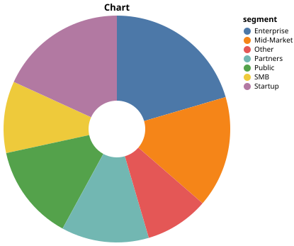
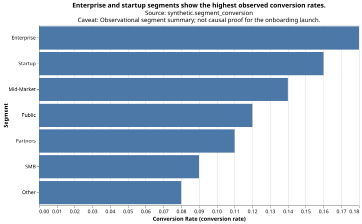

# chart-contract

A lightweight Python harness for claim-first, audited analytical charts.

Charts should satisfy analytical contracts, not just render.

`chart-contract` helps analysts and AI agents produce claim-first charts that can be audited before sharing. A chart should not just render; it should declare what it claims, what data supports it, and what could mislead the reader. Charts are reasoning artifacts, not decorations.

Stop beautiful AI charts from smuggling weak claims.

## Why This Matters

AI-generated charts can look plausible while hiding weak claims, missing units, missing sources, misleading visual forms, or causal overreach. `chart-contract` makes those assumptions explicit before the chart is shared.

The audit also catches single-point trend claims: a directional trend needs at least two observations, enforced by `data.trend.min_points`.

It is a chart-contract harness:

`claim -> data contract -> visual choice -> audit -> render`

It is intentionally not a full visualization library, not a dashboard tool, and not an AI chart generator.

## Visual Proof

| Bad chart | Corrected chart |
| --- | --- |
|  |  |

The bad chart renders, but the audit flags the weak claim, missing source, generic title, and arc/category issue.
The corrected chart switches to a sorted bar chart that is easier to compare.
It keeps the claim narrower, with source and unit metadata visible.
The caveat keeps the interpretation descriptive rather than causal.

Outputs from the hero demo:

- [Corrected Vega-Lite spec](examples/output/corrected_chart.vl.json)
- [Audit report, Markdown](examples/output/bad_chart_audit.md)
- [Audit report, JSON](examples/output/bad_chart_audit.json)
- [Bad chart SVG](examples/output/bad_chart.svg)
- [Corrected chart SVG](examples/output/corrected_chart.svg)

See [docs/AUDIT_RULES.md](docs/AUDIT_RULES.md) for the rule reference behind these findings.

The hero demo includes lightweight rendered charts alongside the audit artifacts so the first impression is inspectable without extra tooling.

## Why not just Altair, Great Expectations, or a checklist?

| Tool | What it does |
| --- | --- |
| Altair / Vega-Lite | Renders charts. |
| Great Expectations | Validates data expectations. |
| Dashboard QA checklists | Depend on humans remembering the steps. |
| `chart-contract` | Audits claim + data + visual choice + provenance before sharing. |

`chart-contract` complements these tools rather than replacing them.

## Quickstart

```bash
python -m pip install -e ".[dev]"
python examples/bad_to_good_chart.py
pytest
```

## CLI Audit Gate

Use the CLI as the front door for agent-gated chart checks:

```bash
chart-contract audit spec examples/traps/causal_claim_missing_caveat.vl.json \
  --data examples/traps/causal_claim_missing_caveat.csv \
  --claim "$(cat examples/traps/causal_claim_missing_caveat.claim.txt)"
```

First-party `Chart` renderers also preserve the exact analytical claim in
`spec.usermeta.claim`. For those self-contained specs, `--claim` may be omitted and the
embedded claim becomes the audited/bound claim. If both an embedded claim and `--claim` are
present, they must match exactly; a mismatch is `BLOCK` via
`contract.claim.consistency`. External specs without `usermeta.claim` keep the existing
explicit-`--claim` workflow.

Claim identity is provenance, not proof: matching text does not establish that the claim is
true or supported.

Representative output:

```text
Verdict: REVIEW
Summary: PASS=5 WARN=1 FAIL=0
Findings:
- WARN claim.causal_support: Claim uses causal language without a caveat or causal evidence metadata. Suggestion: Add a caveat or spec['usermeta']['causal_evidence']=True when justified.
```

Exit behavior:

- `READY` exits `0`.
- `REVIEW` exits `0` by default and `1` when `--warnings-as-errors` is set.
- `BLOCK` exits `1`.
- `--fail-on READY|REVIEW|BLOCK` is also available for explicit thresholds; `READY` is mechanically valid but means the command will fail for any verdict.

For more agent-facing guidance on v0.2.0, see [docs/AGENT_INTEGRATION.md](docs/AGENT_INTEGRATION.md), the runnable CLI traps in [examples/traps/README.md](examples/traps/README.md), and the older Python probes in [examples/quality_traps.py](examples/quality_traps.py). `Chart.from_prompt()` is intentionally not part of the release.

## Bad Chart -> Audit -> Corrected Chart

The repo leads with a risky chart example because that is the point of the package: catch weak analytical defaults before a chart gets shared.

```python
import pandas as pd
from chart_contract import Chart, audit_spec

df = pd.DataFrame(
    {
        "segment": ["SMB", "Enterprise", "Mid-Market", "Public", "Startup", "Partners", "Other"],
        "conversion_rate": [0.09, 0.18, 0.14, 0.12, 0.16, 0.11, 0.08],
    }
)

bad_vega_lite_spec = {
    "mark": {"type": "arc", "innerRadius": 40},
    "title": "Chart",
    "encoding": {
        "theta": {"field": "conversion_rate", "type": "quantitative"},
        "color": {"field": "segment", "type": "nominal"},
    },
}

findings = audit_spec(
    spec=bad_vega_lite_spec,
    data=df,
    claim="The onboarding launch caused conversion lift across customer segments.",
)

corrected = Chart.rank(
    data=df.sort_values("conversion_rate", ascending=False),
    x="segment",
    y="conversion_rate",
    claim="Enterprise and startup segments show the highest observed conversion rates.",
    source="synthetic.segment_conversion",
    unit="conversion rate",
    caveat="Observational segment summary; not causal proof for the onboarding launch.",
)
```

Representative audit output from `python examples/bad_to_good_chart.py`:

```text
PASS contract.claim.present
WARN contract.source.present
WARN labels.title.quality
WARN claim.causal_support
FAIL visual.arc.category_count
PASS readability.color.category_count
```

Run the full hero demo with:

```bash
python examples/bad_to_good_chart.py
```

It audits the risky pie-like chart, prints PASS/WARN/FAIL findings, and writes a corrected Vega-Lite spec to [examples/output/corrected_chart.vl.json](examples/output/corrected_chart.vl.json).

## API

```python
import pandas as pd
from chart_contract import Chart

df = pd.DataFrame(
    {
        "week": ["2026-05-01", "2026-05-08", "2026-05-15"],
        "conversion_rate": [0.12, 0.14, 0.16],
    }
)

chart = Chart.trend(
    data=df,
    x="week",
    y="conversion_rate",
    claim="Conversion improved after onboarding launch",
    source="warehouse.funnel_events",
    unit="conversion rate",
    numerator="converted_sessions",
    denominator="eligible_sessions",
    cohort="sessions eligible for the onboarding funnel",
    event={"x": "2026-05-08", "label": "Onboarding launch"},
    caveat="Observational trend; not causal proof.",
)

report = chart.audit()
spec = chart.to_vega_lite()
altair_chart = chart.to_altair()
```

### Percent values: declare the raw scale

If a metric is presented as percent, make the raw representation explicit instead of relying
on value-range guesses:

```python
chart = Chart.trend(
    data=df,
    x="week",
    y="conversion_rate",
    claim="Observed conversion increased.",
    source="warehouse.funnel_events",
    unit="percent",
    value_representation="fraction",  # 0.42 means 42%
)
```

Use `value_representation="percentage_points"` when raw `42` means 42%. Missing
representation produces `REVIEW`; unsupported or contradictory percent semantics can
`BLOCK`. The first-party renderer formats fractional percent values for display but never
rescales the underlying data.

Generic `rate` units are deliberately **not** assumed to be percentages. See
[Percent value semantics](docs/PERCENT_SEMANTICS.md) for the deterministic contract and
external Vega-Lite behavior.

### Metric definitions: bind the business meaning

A stable field name does not guarantee a stable metric definition. When a metric catalog or
version is available, preserve that identity explicitly:

```python
chart = Chart.trend(
    data=df,
    x="period",
    y="active_users",
    claim="Observed active users changed.",
    source="warehouse.product_metrics",
    unit="users",
    metric_id="monthly_active_users",
    metric_definition="Unique users with at least one qualifying session in the measurement window.",
    metric_version="v3",
    metric_basis_field="metric_version",
)
```

The optional `metric_basis_field` checks every supplied row against the declared version.
Mixed `v1` / `v2` evidence then `BLOCK`s even when the quantitative field is still named
`active_users`.

The contract is opt-in and does not infer metric semantics from field names, titles, claims,
units, or sources. A match proves identity consistency only, not that upstream computation
implemented the definition correctly. See
[Metric definition identity contract](docs/METRIC_DEFINITION_CONTRACT.md).

### Measurement units: bind source and display semantics

A displayed unit does not prove every source row was measured in that unit. When unit identity
or conversion matters, preserve it explicitly:

```python
chart = Chart.trend(
    data=df,
    x="period",
    y="revenue_kusd",
    claim="Observed revenue changed.",
    source="warehouse.revenue",
    unit="thousand USD",
    source_unit="USD",
    conversion_kind="scale",
    conversion_factor=0.001,
    conversion_basis="1 thousand USD = 1000 USD",
    source_value_field="revenue_usd",
    source_unit_basis_field="source_unit",
)
```

For fixed-scale conversions, the audit recomputes
`displayed_value = source_value * conversion_factor` from supplied evidence. A row-level
source-unit field can also catch mixed identities such as USD and EUR under one displayed unit.

Version 1 deliberately does not fetch FX rates, perform silent conversions, support time-varying
factors, or model offset conversions such as Celsius/Fahrenheit. The contract verifies declared
identity/fixed-factor arithmetic; it does not certify the external conversion basis. See
[Unit conversion contract](docs/UNIT_CONVERSION_CONTRACT.md).

### Population scope: say what the evidence represents

A clean dataset does not establish whether the evidence is the whole population or a sample.
When population semantics matter, declare them explicitly:

```python
chart = Chart.trend(
    data=df,
    x="period",
    y="active_users",
    claim="Observed active users changed.",
    source="warehouse.sampled_users",
    unit="users",
    evidence_scope="sample",
    population="All eligible product users",
    population_size=100_000,
    sample_size=2_500,
    sampling_method="stratified",
    generalizes_to_population=True,
)
```

Optional `sample_member_field` and `weight_field` make row-level member counts and sampling
weights auditable when the supplied evidence is actually at that grain. The audit deliberately
does **not** equate plotted row count with sample size, because aggregated charts may summarize
many sampled units.

Population generalization is explicit metadata rather than broad claim-text NLP. A narrow
claim trigger also requires `REVIEW` when wording explicitly says `sample of`,
`sampled from`, `survey respondent(s)`, or `census of` but no population contract
is declared. Declaring generalization from convenience/quota/unknown/other sampling also
produces `REVIEW`; a passing probability-method declaration still does not prove
representativeness or unbiased inference. See
[Population and sampling contract](docs/POPULATION_SAMPLING_CONTRACT.md).

### Uncertainty intervals: say what the error bars mean

Error bars are not self-describing. For trend/compare charts, bind the estimate to explicit
lower/upper fields plus interval kind, level, and method:

```python
chart = Chart.trend(
    data=df,
    x="period",
    y="estimate",
    claim="Observed estimates are shown with a 95% confidence interval.",
    source="warehouse.model_output",
    unit="users",
    interval_lower_field="lower",
    interval_upper_field="upper",
    interval_kind="confidence",
    interval_level=0.95,
    interval_method="wald",
)
```

The audit requires complete finite bounds satisfying `lower <= estimate <= upper`, and
first-party specs visibly bind those fields as an interval rule. Narrow claim wording such as
`95% CI` or `90% credible interval` must match the declared kind and level.

Version 1 does **not** infer significance from interval overlap or certify statistical coverage,
model assumptions, or calibration. See
[Uncertainty interval contract](docs/UNCERTAINTY_CONTRACT.md).

### Control totals: reconcile component evidence

A component decomposition can look complete while omitting or double-counting part of the
business. For additive `rank` / `compare` evidence, bind the supplied components to one
explicit scalar control total:

```python
chart = Chart.rank(
    data=df,
    x="region",
    y="revenue",
    claim="Regional revenue components are shown.",
    source="warehouse.region_revenue",
    unit="USD",
    control_total=11_800_000,
    control_total_source="finance.company_revenue",
    reconciliation_tolerance=1.0,
)
```

The audit recomputes the component sum, residual, and represented share when meaningful.
A 9.1M component sum against an 11.8M control total `BLOCK`s and reports the 2.7M residual
rather than inventing an `Unknown` bucket.

Version 1 uses fixed sum semantics only and rejects percent/rate/ratio metrics. Reconciliation
applies to the supplied component evidence; top-N display omission remains independently governed
by the rank comparison-set contract. A passing reconciliation does not prove the control source
is authoritative or that the component taxonomy is substantively complete. See
[Control-total reconciliation contract](docs/RECONCILIATION_CONTRACT.md).

### Rates and ratios: declare what they are "of"

A percentage, rate, or ratio is not semantically complete without numerator/denominator identity:

```python
chart = Chart.compare(
    data=df,
    x="segment",
    y="conversion_rate",
    claim="Enterprise has the higher observed conversion rate.",
    source="warehouse.funnel_summary",
    unit="conversion rate",
    numerator="converted_users",
    denominator="eligible_sessions",
    cohort="sessions eligible for the onboarding funnel",
)
```

Missing numerator/denominator identity on a ratio-like metric produces `REVIEW`. A declared
`denominator_basis_field` can make row-level semantics auditable: mixed identities such as
`visitors` and `signups` under one displayed conversion-rate metric `BLOCK`.

This contract records semantic identity only. It does not recompute the rate or certify
upstream SQL arithmetic. See [Ratio denominator and cohort contract](docs/RATIO_CONTRACT.md).

### Grain: say what one row represents

Repeated rows can be legitimate detail or accidental join fanout. Make the source-row identity explicit:

```python
chart = Chart.compare(
    data=df,
    x="month",
    y="revenue",
    claim="Monthly revenue is shown by month.",
    source="warehouse.account_month",
    unit="dollars",
    grain_fields=["account_id", "month"],
)
```

If `account_id + month` is duplicated, the chart `BLOCK`s. If that grain is finer than the displayed month, first-party rendering also refuses to collapse it because chart-contract will not guess `sum` versus `mean`.

External Vega-Lite specs may declare one encoding-level aggregate together with source/output grain. The aggregate remains transform-inventoried and lineage-bound. See [Aggregation grain contract](docs/GRAIN_CONTRACT.md).

### Metric directionality: distinguish movement from improvement

An increase is not always an improvement. Latency, cost, churn, defects, and error rates are
often lower-is-better metrics.

```python
chart = Chart.trend(
    data=df,
    x="period",
    y="latency_ms",
    claim="Latency worsened.",
    source="synthetic.latency",
    unit="milliseconds",
    metric_direction="lower_is_better",
    baseline_field="period",
    baseline_value="before",
    target_value="after",
    change_type="absolute",
    declared_change=50,
)
```

Version 1 supports `higher_is_better`, `lower_is_better`, and `neutral`.
Only narrow evaluative wording such as `improved`, `better`, `worsened`, `worse`,
and `deteriorated` is adjudicated. Plain `increased` / `decreased` remains descriptive.

When an explicit comparison already exists, evaluative wording without directionality produces
`REVIEW`. When directionality is declared, evaluative wording without an explicit comparison
baseline also produces `REVIEW`. Ordinary legacy prose does not invent a comparison requirement.
Wording that contradicts the declared direction and observed baseline-to-target movement
`BLOCK`s. A passing contract does not prove the metric is a valid objective or
that optimization is causally justified. See
[Metric directionality contract](docs/DIRECTIONALITY_CONTRACT.md).

### Metric targets: bind the threshold and the evaluated observation

Directionality does not tell you whether a metric actually cleared a business threshold.
Declare one scalar target, one operator, and the exact observation to evaluate:

```python
chart = Chart.trend(
    data=df,
    x="period",
    y="quality_score",
    claim="Quality score met target.",
    source="warehouse.quality",
    unit="points",
    metric_target=80,
    target_operator="at_least",
    target_selector_field="period",
    target_selector_value="after",
)
```

Version 1 supports `at_least`, `at_most`, and `equal`, plus an optional absolute
`target_tolerance`. The audit stores the selected observed value, target gap, and recomputed
`target_met` receipt. First-party trend/compare specs visibly draw the threshold as a rule.

Narrow wording such as `met target`, `hit target`, or `missed target` must agree with the
contract. Explicit target-status wording without metadata produces `REVIEW`. The harness does
not infer the latest row, acceptable ranges, business materiality, or target authority. See
[Metric target contract](docs/TARGET_CONTRACT.md).

### Comparisons: bind the baseline and the arithmetic

For explicit change claims, declare exactly which observations are being compared and what
kind of change is meant:

```python
chart = Chart.trend(
    data=df,
    x="year",
    y="revenue",
    claim="Revenue increased by 20%.",
    source="warehouse.revenue",
    unit="dollars",
    baseline_field="year",
    baseline_value="2025",
    target_value="2026",
    change_type="percent_change",
    declared_change=20.0,
)
```

Supported change types are `absolute`, `percentage_points`, `percent_change`, and
`ratio`. First-party specs preserve the baseline/target metric values and recomputed change
as receipts, so stale arithmetic can be caught later.

The claim checker deliberately recognizes only narrow explicit numeric phrases. That is enough
to catch the classic `40% -> 60%` error: it is +20 percentage points or +50% relative
change, not “up 20%.” See [Comparison baseline contract](docs/COMPARISON_CONTRACT.md).

### Time comparisons: make the exposure window explicit

A baseline comparison can have correct arithmetic and still compare unlike periods. Declare the
actual calendar or rolling windows:

```python
chart = Chart.trend(
    ...,
    baseline_field="period",
    baseline_value="2026-09-01",
    target_value="2026-10-01",
    change_type="absolute",
    declared_change=20,
    window_kind="calendar",
    window_granularity="month",
    baseline_start="2026-09-01",
    baseline_end="2026-09-30",
    target_start="2026-10-01",
    target_end="2026-10-31",
    baseline_complete=True,
    target_complete=True,
)
```

Complete-vs-partial comparisons `BLOCK`; unequal rolling windows `BLOCK`; unequal complete
calendar durations such as February vs March produce `REVIEW`. No automatic prorating or
normalization is performed. See [Time-window comparability contract](docs/TIME_WINDOW_CONTRACT.md).

### Vega-Lite transforms: make them visible

External specs with explicit analytical transforms must declare the exact transform kinds they
contain:

```json
{
  "transform": [{"filter": "datum.region === 'East'"}],
  "usermeta": {
    "transform_contract": {
      "declared": ["filter"]
    }
  }
}
```

The audit emits one `transform.inventory` finding per transform occurrence, including its
exact spec location, and `transform.declaration` blocks missing, stale, malformed, or
incomplete declarations. Encoding-level `aggregate`, `bin`, `stack`, and `timeUnit`
operations are inventoried too.

This is structural transparency, not transform execution: a matching declaration does not
prove a calculation, filter, window, lookup, or regression is analytically correct. See
[Vega-Lite transform contract](docs/TRANSFORM_CONTRACT.md).

### Transform receipts: bind the exact operation

Kind declarations catch hidden `filter` versus `calculate` semantics; lineage receipts go one
step further and bind each transform occurrence to its exact canonical structural payload:

```python
from chart_contract import build_transform_lineage

spec["usermeta"]["transform_lineage"] = build_transform_lineage(spec)
```

A changed filter expression, grouping field, window sort, calculate formula, or stale receipt
then `BLOCK`s even when the transform kind itself is unchanged. Receipts also expose bounded
input/output field lineage where Vega-Lite makes it structurally recoverable.

This is still provenance-by-structure, not transform execution or upstream SQL/dbt/Python
attestation. See [Transform lineage receipts](docs/TRANSFORM_LINEAGE.md).

### Rank charts: explicit top-N, ties, and omissions

`Chart.rank(..., top_n=N)` now treats truncation as part of the analytical contract rather
than a display convenience.

- duplicate categories `BLOCK` instead of being silently aggregated;
- bars use explicit descending metric order;
- exact cutoff ties are all included, producing `REVIEW` when displayed count exceeds N;
- first-party specs preserve the full source rows and declare eligible/displayed/omitted
  category counts;
- the selected top-N category filter is itself transform-declared and lineage-bound.

That means a later audit can catch a stale count, reordered rank, or tampered selected set.

Top-N charts can also declare `omitted_behavior="exclude"` or
`omitted_behavior="aggregate_other"`. The resulting comparison-set contract records omitted
metric mass; explicit exclusion requires review when the omitted categories contain at least
half of eligible non-negative metric mass. `aggregate_other` preserves full source rows and
sums the long tail into a last-position Other summary bucket; ratio-like metrics are never
summed this way.

See [Rank and top-N contract](docs/RANK_CONTRACT.md).

### Evidence coverage: show how much data survives

A chart can still look convincing after null analytical fields silently remove many source
rows. `chart-contract` now reports complete-case evidence coverage for the fields that drive
the visible chart:

```text
PASS   90%+ usable rows
REVIEW 50%-<90%
BLOCK  <50%
```

Grouped comparisons also warn when eligible groups differ by 20 percentage points or more in
usable-row coverage. That is a missingness-review signal, not proof of bias or causality.

Tooltip-only fields do not reduce the main evidence coverage, and chart-contract does not
invent coverage for transform-derived fields it cannot reconstruct. See
[Evidence coverage and missingness](docs/EVIDENCE_COVERAGE.md).

For a minimal pre-share gate, inspect `report.verdict` before you send the chart onward: `READY` means the audit found only `PASS` checks, `REVIEW` means warnings need human judgment, and `BLOCK` means at least one failure should stop sharing until fixed. `report.verdict` is the authoritative gate field; `report.passed` only means there are no `FAIL` findings, so a `REVIEW` report can still have `passed=True`.

Supported Python API front-door intents:

- `Chart.trend()`
- `Chart.rank()`
- `Chart.compare()`
- `Chart.histogram()`
- `Chart.boxplot()`
- `Chart.violin()`
- `Chart.qq()`
- `Chart.ecdf()`
- `Chart.residual()`
- `Chart.set_membership()`
- `Chart.process_tree()`
- experimental `audit_spec()`

## Scope and Non-Goals

- Not a full visualization library
- Not a dashboard tool
- Not an AI chart generator
- No automatic chart correction

## Design Principles

- Claim first
- Data contract before rendering
- Audit before sharing
- Visual integrity over decoration
- Provenance and caveats visible

The audit layer uses Tufte-inspired visual integrity checks. It does not claim to be Tufte-compliant or Tufte-certified.

## Distribution Charts

Use distribution intents when the claim is about spread, shape, outliers, or typical values rather than a trend or rank.

- Histograms are good for one metric's distribution.
- Boxplots are good for robust summaries and outliers.
- Violin plots are good for shape, but they need more observations to stay readable.

Run `python examples/distribution_charts.py` to write:

- `examples/output/histogram_chart.vl.json`
- `examples/output/boxplot_chart.vl.json`
- `examples/output/violin_chart.vl.json`

These charts stay inside the same claim-first audit flow and are not a full visualization library.

## Statistical Diagnostic Plots

Use the statistical intents when the claim is about distribution fit, cumulative shape, or model residual behavior.

- `Chart.qq()` compares observed quantiles with a fitted normal reference line. The normal reference is the only supported distribution in this slice.
- `Chart.ecdf()` shows cumulative probability without choosing histogram bins.
- `Chart.residual()` plots residuals against fitted values and always includes a zero reference line.

Run `python examples/statistical_diagnostics.py` to write QQ, ECDF, and residual Vega-Lite specs into `examples/output/`.

These diagnostics audit data and rendering contracts; they do not certify normality or model adequacy. See [diagnostic claim guidance](docs/DIAGNOSTIC_CLAIMS.md) for agent-ready wording patterns.

### Diagnostic claim guidance

Diagnostic claims are often absence claims, so they should be narrower than ordinary descriptive claims.

- Weak QQ claim: “The data are normal.”
- Stronger QQ claim: “Observed quantiles broadly track the fitted normal reference through the center, while the outer tails depart from the line.”
- Weak residual claim: “There is no pattern in the residuals.”
- Stronger residual claim: “Residuals remain centered near zero across the observed fitted-value range, with no large monotonic or curved structure at the audit thresholds.”

Good diagnostic claims:

- describe observed alignment or departure rather than certify a distribution or model;
- name tail, trend, curvature, tie, crossing, or sample-size limitations;
- keep the required fitted or zero reference line visible;
- use wording such as “broadly consistent,” “appears,” or “within the observed range” when the evidence is visual and finite.

### Try the diagnostic traps

The runnable fixtures in [examples/traps/README.md](examples/traps/README.md) make the diagnostic boundaries concrete:

- [Severe QQ tail departure](examples/traps/qq_heavy_tails.vl.json) → `REVIEW` because the normality claim overstates the evidence.
- [QQ plot without a reference line](examples/traps/qq_missing_reference_line.vl.json) → `BLOCK` because the visual contract is incomplete.
- [Residuals with an obvious fitted-value pattern](examples/traps/residual_obvious_pattern.vl.json) → `REVIEW` because “no pattern” contradicts the data.
- [Four-point residual diagnostic](examples/traps/diagnostic_tiny_sample.vl.json) → `BLOCK` because the sample cannot support interpretation.

Each fixture includes a Vega-Lite spec, CSV data, and separate claim text so the verdict can be reproduced directly through the CLI.

## Set Membership Charts

Use `Chart.set_membership()` when the claim is about exactly two sets: overlap, exclusion, subset relationships, or coverage of a declared universe.

The input is one row per member plus two explicit boolean or `0`/`1` membership columns. The audit blocks missing columns, non-binary membership, null identifiers, and duplicated members before region counts are rendered.

```python
frame = pd.DataFrame(
    {
        "customer_id": ["c1", "c2", "c3", "c4"],
        "email": [1, 1, 0, 0],
        "paid_search": [0, 1, 1, 0],
    }
)

chart = Chart.set_membership(
    data=frame,
    member="customer_id",
    set_a="email",
    set_b="paid_search",
    set_a_label="Email",
    set_b_label="Paid search",
    claim="Email and paid search overlap for one of four customers.",
    source="warehouse.channel_reach",
    title="Customer reach overlap by channel",
)
```

The renderer supports partial overlap, disjoint, subset, and equal-set relationships. Circle geometry is schematic; labeled A-only, overlap, B-only, and neither counts are authoritative and are preserved in `usermeta`.

Run `python examples/set_membership.py` to write [the generated Vega-Lite proof artifact](examples/output/set_membership_chart.vl.json). See [the set membership contract](docs/SET_MEMBERSHIP.md) for the evidence shape, audit rules, and intentional two-set boundary.

## Process Tree / Flowchart

Use `Chart.process_tree()` for a rooted decision tree or process map: one entry node,
directed parent-child steps, and optional branch labels such as `Yes` / `No`.

```python
frame = pd.DataFrame(
    {
        "step_id": ["start", "review", "approve", "revise"],
        "parent_id": [None, "start", "review", "review"],
        "step": ["Request received", "Review request", "Approve", "Revise"],
        "branch": [None, None, "Yes", "No"],
    }
)

chart = Chart.process_tree(
    data=frame,
    node="step_id",
    parent="parent_id",
    label="step",
    branch="branch",
    claim="Requests follow intake, review, and then revision or approval.",
    source="workflow.request_approval",
    title="Request approval flow",
)
```

The renderer uses a deterministic top-down layout with boxed nodes, elbow connectors,
directional arrowheads, and optional branch labels. Sibling order follows input row order.

The audit blocks duplicate/null node IDs, blank labels, multiple roots, dangling parent
references, and cycles before rendering. Geometry is schematic: box size and spacing do not
encode duration, probability, importance, or volume.

Run `python examples/process_tree.py` to write `examples/output/process_tree.vl.json`.
See [the process-tree contract](docs/PROCESS_TREE.md) for the evidence shape and intentional
rooted-tree boundary.

## Companion Artifact

This repo was built using `ai-engineering-skills` and is intended as the analytical-integrity proof artifact companion to `context-to-action-skills`.

See the [agent workflow case study](docs/AGENT_WORKFLOW_CASE_STUDY.md) and [build manifest](artifacts/BUILD_MANIFEST.md) for the proof trail.

## Part of the Suite

See the [suite map](docs/SUITE_MAP.md) for how `chart-contract`, `ai-engineering-skills`, and `context-to-action-skills` fit together as one story.
